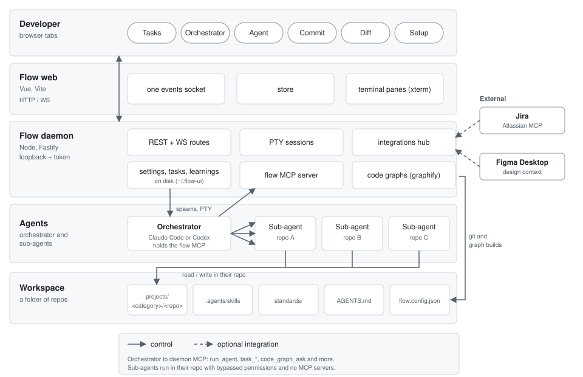

# Architecture

Flow is one local daemon and one web page. The daemon runs on your machine,
owns every terminal session and agent process, and serves the page. Agents work
inside your workspace folder; you watch and steer them from the browser.

```mermaid
flowchart TB
  subgraph dev["1. Developer"]
    tabs["Tasks · Orchestrator · Agent · Commit · Diff · Setup"]
  end
  subgraph web["2. Flow web (Vue, Vite)"]
    socket["one events socket"]
    store["store"]
    panes["terminal panes (xterm)"]
  end
  subgraph daemon["3. Flow daemon (Node, Fastify, loopback + token)"]
    routes["REST + WS routes"]
    pty["PTY sessions"]
    mcp["flow MCP server"]
    hub["integrations hub"]
    graphs["code graphs (graphify)"]
    disk[("~/.flow-ui: settings, tasks, learnings")]
  end
  subgraph agents["4. Agents"]
    orch["Orchestrator (Claude Code or Codex)"]
    sub["Sub-agents, one per repo (no MCP, bypass permissions in the repo)"]
  end
  subgraph ws["5. Workspace"]
    repos["projects/&lt;category&gt;/&lt;repo&gt;"]
    files["AGENTS.md · flow.config.json · standards/ · .agents/skills"]
  end
  jira["Jira (Atlassian MCP)"]
  figma["Figma Desktop"]

  tabs <-->|HTTP / WS| routes
  socket --- routes
  routes --- pty
  pty -->|spawns| orch
  pty -->|spawns| sub
  orch -->|MCP: run_agent, task_*, code_graph_ask| mcp
  orch --> sub
  sub -->|read / write| repos
  daemon_ws["git, graph builds"]
  routes --- daemon_ws
  daemon_ws --> repos
  hub -.-> jira
  hub -.-> figma
  graphs --> repos
  routes --- disk
```

## Daemon (`daemon/src`)

A Fastify app started by `main.ts`, with routes in `routes/<domain>.ts`, one
group per domain.

- **Config and workspace.** `common/config.ts` resolves the workspace (see
  README, "Workspace layout"), parses `flow.config.json`, and exposes
  `getConfig()` and `reloadConfig()`. Projects are discovered from the folders
  on every request, so a reload is enough after files change.
- **Sessions.** `pty.ts` runs every agent and command in a pseudo-terminal
  (`node-pty`). Output is buffered for replay, streamed over
  `/api/sessions/:id/stream`, and watched for prompts that wait on the developer
  (permission menus, y/n). Lifecycle events go out on `/api/events`.
- **Orchestrator.** One long-lived Claude Code or Codex session started in the
  workspace root. It is handed a brief (the delegation rules, workspace list,
  pinned repo) and reaches Flow through the `flow` MCP server, which calls back
  into the daemon over loopback. Its tools include `run_agent` (start a
  sub-agent in a repo), `task_*` (the board) and `code_graph_ask`.
- **Sub-agents.** Started with the repo as their working directory, the
  workspace as an added directory, and `--strict-mcp-config` so they inherit no
  user MCP servers. The standards for their category and the repo's code graph
  are added to the prompt.
- **Integrations hub.** One connection each to the Atlassian (Jira) and Figma
  MCP servers, shared by every agent. Optional: with neither configured, the
  rest of Flow works.
- **Code graphs.** `codeGraph.ts` builds a graphify graph per repo under
  `~/.flow-ui/graphs`. The repo gets only a `.graphifyignore`, hidden through
  `.git/info/exclude`.
- **Git.** Status, branch switch, diff and commit run as plain `git` in the repo.
  A commit involves no agent; the message comes from the Commit tab.
- **AI Setup.** `aiSetup.ts` starts a Claude session in the new workspace that
  links your repos, writes the config and standards, and reloads the daemon's
  config through `POST /api/config/reload`.

## Web (`web/src`)

A Vue 3 single-page app built with Vite. In development Vite serves it on port
5180 and proxies `/api` to the daemon.

- **One socket.** `store.js` opens one `/api/events` connection and fills the
  session list, the active context, sync state and integration status from it.
  Views read the store; they do not poll for changes.
- **Tabs.** Tasks, Orchestrator, Agent, Commit, Diff and Setup. Optional tabs
  can be hidden in Setup. Each tab is a view in `views/`.
- **Terminals.** `TerminalPanel.vue` attaches an xterm instance to one session
  stream. `CommandRunner.vue` shows the session a button started, so Commit and
  AI Setup stream in the same place as agents.
- **API.** `api.js` is the only place that calls the daemon. It sends the token
  in the `X-Flow-Token` header.

## Security model

- **Loopback only.** The daemon listens on `127.0.0.1` by default. Nothing on
  the network can reach it.
- **One-time token.** Startup prints a URL with a token. The page exchanges it
  for the session token, which every API call and WebSocket must present.
  `FLOW_TOKEN` pins it if you need a fixed value.
- **Agents run with bypassed permissions, inside the workspace.** Claude runs
  with `--permission-mode bypassPermissions` and Codex with
  `--ask-for-approval never`. Each sub-agent's working directory is its repo, so
  its file access is that repo. A repo is not a sandbox: an agent can still run
  any shell command as your user, so point Flow only at code you trust agents to
  change.
- **The human confirms destructive actions.** Commits, deletes and any tool
  marked destructive ask in the UI before they run. The Jira read-only switch in
  Setup refuses every Jira write.

## Files on disk

| Path                                                                         | What                                                   | Who writes it    |
| ---------------------------------------------------------------------------- | ------------------------------------------------------ | ---------------- |
| `<workspace>/projects/...`                                                   | symlinks (or clones) of your repos                     | you, or AI Setup |
| `<workspace>/flow.config.json`, `AGENTS.md`, `standards/`, `.agents/skills/` | workspace context for agents                           | you, or AI Setup |
| `~/.flow-ui/` (or `FLOW_HOME`)                                               | settings, tasks, learnings, graphs, parked sessions    | the daemon       |
| `<repo>/.graphifyignore`                                                     | keeps vendor bundles out of the graph; hidden from git | code graph build |
